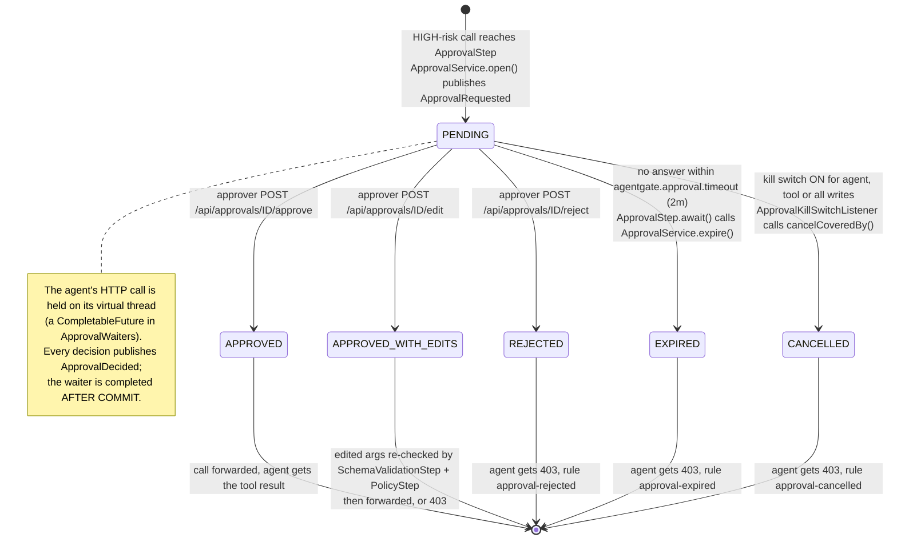

# Approval lifecycle (FR4) — State pattern

Code: `approval.ApprovalState` (enum, stored in `approval_requests.state`) → behaviour objects `PendingState`, `ApprovedState`, `ApprovedWithEditsState`, `RejectedState`, `ExpiredState`, `CancelledState` (interface `ApprovalStateBehavior`). Only `PendingState` allows transitions; every other move throws `IllegalApprovalTransitionException` → **409**.

| From → to | Trigger (real code) | What the agent receives |
|---|---|---|
| — → PENDING | `ApprovalStep.handle` → `ApprovalService.open` | nothing yet (call waits) |
| PENDING → APPROVED | `ApprovalController` → `ApprovalService.approve` | the tool's result |
| PENDING → APPROVED_WITH_EDITS | `ApprovalService.approveWithEdits` | result of the **edited** call, or 403 `approval-edit-invalid` / the policy rule |
| PENDING → REJECTED | `ApprovalService.reject` | 403 `approval-rejected` + approvalId, reason |
| PENDING → EXPIRED | timeout in `ApprovalStep.await` → `ApprovalService.expire` | 403 `approval-expired` |
| PENDING → CANCELLED | `KillSwitchActivated` → `ApprovalKillSwitchListener` | 403 `approval-cancelled` |
| any final state → anything | `ApprovalStateBehavior` default methods | approver gets **409** |

**Race rule:** if the timeout fires at the same moment an approver decides, `expire()` gets a 409 from the state object and the human's decision wins (`ApprovalStep.await`, catch block). The row lock (`findForUpdate`) makes the two decisions run one after the other.

## Note (code vs. description)

- **Expiry is done by the waiting call, not by a scheduler.** There is no `@Scheduled` sweeper. If the gateway **restarts while calls are held**, those rows stay `PENDING` forever (nobody waits for them and no timer expires them), and they still show on the approvals page. Approving one later is harmless (no waiter → nothing is forwarded), but the page and the data are misleading. See ADR-0001, "Consequences". Fix idea: on startup, expire every PENDING row whose `expires_at` is in the past.
