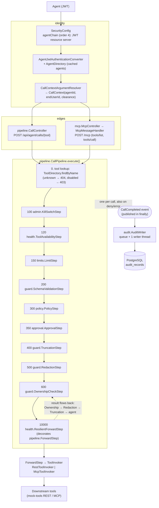
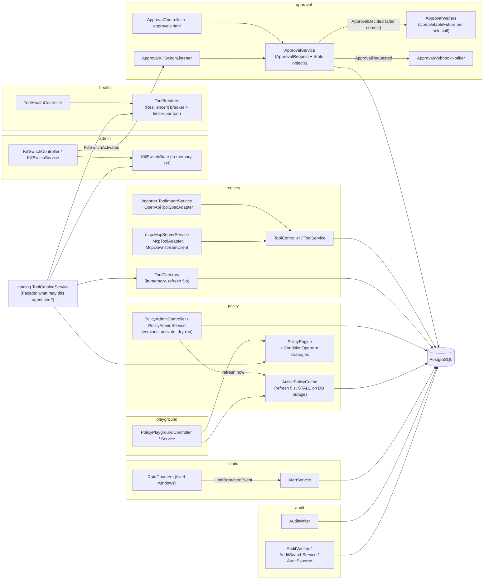

# C4 Level 3 — Components of the `gateway` container

Package names are Spring Modulith-style modules under `com.agentgate.gateway`. Class names are the real ones.

## 1. The call path (one tool call)

Steps are `CallStep` beans sorted by `@Order` (`pipeline.CallStepOrder`). `CallPipeline` logs the real order at startup (`Call pipeline: [...]`).

### Step order and what each step does

| Order | Class | Request side (before `chain.proceed`) | Result side (after) | FR |
|---|---|---|---|---|
| — | `CallPipeline` | finds the tool in `ToolDirectory`; unknown/disabled tool stops here | publishes `CallCompleted`, records metrics | FR7, C4 |
| 100 | `KillSwitchStep` | disabled agent / tool / all writes → deny | — | FR8 |
| 120 | `ToolAvailabilityStep` | breaker OPEN → 503 fast | — | FR10 |
| 150 | `LimitStep` | rate, daily quota, write blast-radius cap → 429 + `LimitBreachedEvent` | — | FR6 |
| 200 | `SchemaValidationStep` | arguments vs. tool JSON schema → 400 | — | FR5 |
| 300 | `PolicyStep` | `PolicyEngine` on `ActivePolicyCache` snapshot; default deny; dry-run; QA4 fail-closed | — | FR3, QA4 |
| 350 | `ApprovalStep` | HIGH risk → PENDING request, call **waits**; edited args re-run schema + policy | — | FR4 |
| 400 | `TruncationStep` | — | cuts results > 8 KB, adds notice (runs **last**) | FR5 |
| 500 | `RedactionStep` | — | masks email / BD phone / NID by clearance (`DataRedactor` strategies) | FR5 |
| 600 | `OwnershipCheckStep` | — | withholds `getOrder`/`getCustomer` results of another customer (runs **first**) | FR3, QA1 |
| 10000 | `ResilientForwardStep` → `ForwardStep` | per-tool `TimeLimiter` + `CircuitBreaker`, **no retry**; picks invoker by `ToolKind` | — | FR10, FR1 |

**Not a step:** audit. It is an Observer of `CallCompleted` (see `docs/patterns.md`), so even calls stopped by an exception in any step are recorded.

## 2. Supporting components (admin side, state, events)

- **In-memory state read on every call** (no DB round trip on the hot path): `ToolDirectory`, `AgentDirectory`, `ActivePolicyCache`, `KillSwitchState`, `RateCounters`, `ToolBreakers`. This is what keeps QA2 overhead at 8.81 ms p95.
- `ToolCatalogService` feeds both `GET /api/agent/tools` and MCP `tools/list`, so both lists agree (kill switch, policy, breaker all applied).

## Notes (code vs. description)

- **Audit is not a pipeline step** and the **kill switch is not only an admin service**: it is both `KillSwitchService` (admin) and `KillSwitchStep` (first pipeline step, order 100).
- **Limits come before the schema check**, and kill switch / tool availability come before limits. So "schema before policy" is true, but schema is the 4th step, not the 1st.
- The **circuit breaker appears twice**: `ToolAvailabilityStep` (120, fail fast before using quota or a human's time) and `ResilientForwardStep` (10000, the breaker that actually records failures).
- `ForwardStep` is **not a Spring bean**; `health.HealthConfig` creates it and wraps it in `ResilientForwardStep` (Decorator).
