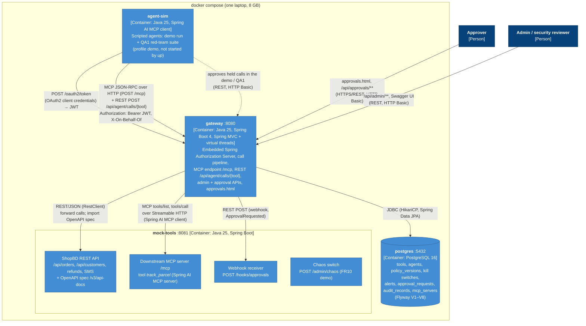

# C4 Level 2 — Containers

What `docker compose up` starts (`docker-compose.yml`), plus `agent-sim` (compose profile `demo`, one-shot).

## Notes (code vs. description)

- **There is no separate "downstream MCP server" container.** The MCP server (`ParcelMcpTools`, tool `track_parcel`) runs **inside `mock-tools`** on `/mcp`, next to the REST API. The gateway registers it as MCP server `shop-parcels` (`DemoToolSeeder` in profile `docker`). It is a separate *endpoint* and *protocol*, not a separate process. Drawn as one container with four parts.
- The agent's REST endpoint is **`/api/agent/calls/{tool}`** (not `/api/calls/{tool}` as in early notes).
- **No Keycloak**: the OAuth2 token endpoint is inside the gateway (embedded Spring Authorization Server, `SecurityConfig` chain 1). Tokens are JWTs signed by the gateway and checked by the gateway's own resource-server chain (chain 4).
- **One database** holds both the policy store and the audit log. That is why QA4 ("policy store unreachable") is tested by stopping PostgreSQL, and why audit records are queued in memory during that outage (see ADR-0002).
- Ports 5432 and 8081 are published to the host only for development and the QA2 baseline.
