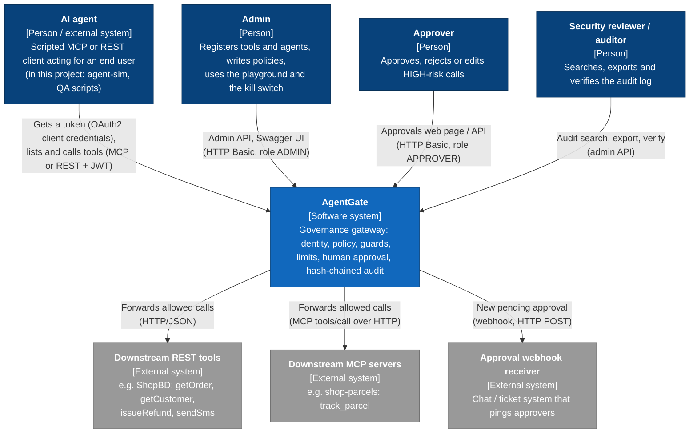

# C4 Level 1 — System context

AgentGate sits between AI agents and the tools they call. Every tool call goes through it: authenticate → kill switch → limits → schema → policy → (human approval) → forward → redact/trim → audit.

## Notes (code vs. description)

- The **security reviewer has no role of its own** in the code. Audit endpoints are under `/api/admin/audit/**`, so the reviewer uses an **ADMIN** login (`SecurityConfig.adminChain`). A read-only `AUDITOR` role would be a small, separate change.
- The approver is notified on **two channels** (FR4): the web page `approvals.html` and the webhook. In the demo the webhook receiver is `mock-tools` (`POST /hooks/approvals`, it only logs).
- Agents never talk to the tools directly; the tools are only reachable through AgentGate in the intended deployment (in `docker-compose.yml` mock-tools also publishes port 8081 for the QA2 baseline measurement).
