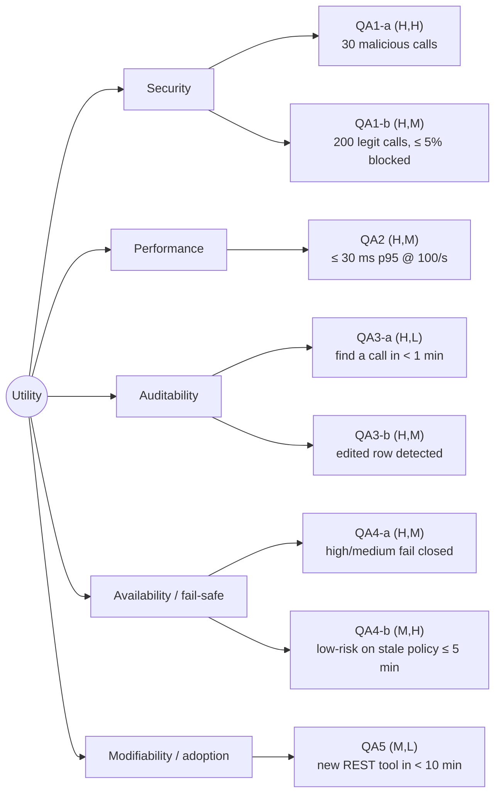

# Utility tree (mini-ATAM)

Ratings are **(Importance, Difficulty)**, each H / M / L. Importance = how much the business (safe AI agents for ShopBD) suffers if the scenario fails. Difficulty = how hard it is to achieve in *this* architecture.

## Scenarios

| ID | Attribute | Stimulus (source, environment) | Response | Measure | (I, D) | Why this rating | Evidence |
|---|---|---|---|---|---|---|---|
| QA1-a | Security | Red-team agent sends 30 scripted malicious calls (injected refunds, cross-customer reads, argument smuggling, forged tokens), normal load | Every call is blocked (401/400/403/429) or held for a human | 100% blocked or held | **(H, H)** | **H:** one leaked refund or customer record is the exact harm the product exists to stop. **H:** attacks hit different layers (identity, schema, policy, ownership of *results*); the first run found 3 real bugs. | `docs/evidence/qa1-redteam.md`: 30/30 |
| QA1-b | Security (usability side) | 200 legitimate calls from support/analytics agents | Allowed (or held and approved) | ≤ 5% wrongly blocked | **(H, M)** | **H:** a gateway that blocks real work gets bypassed. **M:** default deny makes false blocks likely, but they are fixed in policy data, not code. | 0/200 (0.0%) |
| QA2 | Performance | 100 calls/s of a LOW-risk allowed `getCustomer`, warm system, one laptop | Call passes the whole pipeline and returns | Gateway adds ≤ 30 ms p95 (excluding approval waits) | **(H, M)** | **H:** agents chain many calls; slow governance gets switched off. **M:** 10 steps + JSON schema + regex redaction per call, but all policy/limit/kill-switch state is in memory and audit is async. | `qa2-performance.md`: 8.81 ms |
| QA3-a | Auditability | Reviewer gets a complaint with a call id (`X-Call-Id`) or an agent/time range | Audit search shows agent, end user, tool, redacted args, step + rule, approval, outcome | < 1 minute per call | **(H, L)** | **H:** required for incident handling and regulators. **L:** one row per call with all fields; lookup by `callId` is one GET. | `fr7-audit.md` (lookup shown; time not stop-watched yet) |
| QA3-b | Auditability (integrity) | Someone with DB access edits a stored audit row | `verify` reports BROKEN and the first broken `seq` | 100% of edited rows detected | **(H, M)** | **H:** an editable log is worthless as evidence. **M:** hash chain is simple, but needs a single writer to stay linear (ADR-0002); deleting the *last* rows is not detected. | `fr7-audit.md` (f): BROKEN at seq 2 |
| QA4-a | Availability (fail-safe) | PostgreSQL (policy store) stops during traffic | MEDIUM/HIGH-risk calls fail closed with 503 | 100% of med/high calls refused during outage | **(H, M)** | **H:** failing open on a refund tool is a security breach. **M:** needs a clear "store reachable?" state shared by policy, agent and tool caches. | `qa4-failsafe.md` (b): 503 |
| QA4-b | Availability (fail-safe) | Same outage, LOW-risk read calls with a token issued before | Served on last known policies, audited as `stale-policy-allowed`; refused after max-stale | Works up to 5 min, then 503 | **(M, H)** | **M:** nice to keep reads alive, not safety-critical. **H:** every DB touch on the hot path (tools, agents, policies, audit) must survive the outage; audit records must queue in order and the chain must still verify. | `qa4-failsafe.md` (a), (d), (e) |
| QA5 | Modifiability / adoption | A classmate with a new REST service + OpenAPI file | Import via admin API, set risk level, add a policy rule; tool is callable | < 10 minutes, zero code changes | **(M, L)** | **M:** adoption matters but is not safety. **L:** OpenAPI import (Adapter), risk level and policies are all data. | **Not measured yet** (Phase 6 quick-start script) |

## Sensitivity and trade-off points (short)

- **Synchronous hold (ADR-0001)** — sensitivity point for QA2: held calls are *excluded* from the QA2 measure, but each one holds a connection open for up to 2 min.
- **Single async audit writer (ADR-0002)** — trade-off: helps QA2 and QA3-b (linear chain), hurts QA3 completeness (queued records lost on crash) and limits scale-out to one instance.
- **Default deny + schema before policy (ADR-0003)** — trade-off: helps QA1-a, risks QA1-b (false blocks); measured 0%.
- **No retry on writes (ADR-0004)** — helps QA1/safety (no double refund), hurts availability of transient failures.
- **In-memory limits and kill switch** (`docs/adr/ADR-candidate-in-memory-limits.md`) — helps QA2, risk: one instance only.
